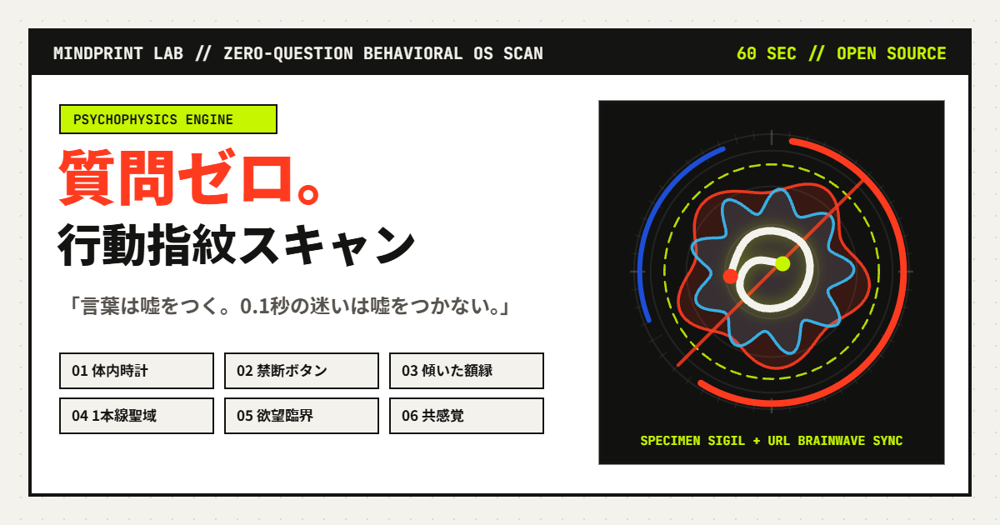
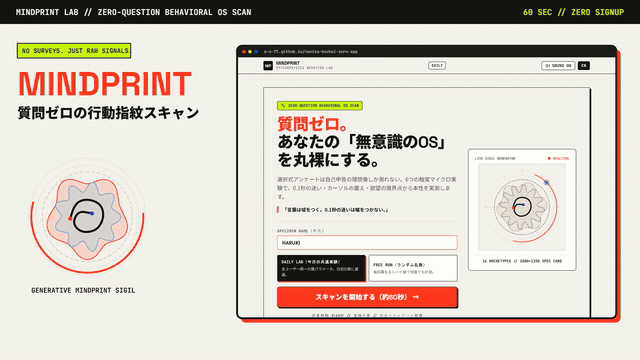

<div align="center">



# MINDPRINT — 質問ゼロの行動指紋スキャン

**「言葉は嘘をつく。0.1秒の迷いは嘘をつかない。」**  
*"Words lie. A 0.1-second hesitation doesn't."*

[](https://a-s-77.github.io/nanika-koukai-suru-app/)
[](https://github.com/a-s-77/nanika-koukai-suru-app/releases/tag/v1.0.0)
[](https://github.com/a-s-77/nanika-koukai-suru-app/releases/tag/v1.0.0)

[](https://www.typescriptlang.org/)
[](https://react.dev/)
[](#)
[](#)

<br />



</div>

---

## なぜ質問ゼロなのか？（Why Zero Questions?）

選択式の性格診断は、質問を読んだ瞬間に「こう見られたい理想の自分」へ回答を寄せることができます。  
**MINDPRINT** は質問を一切出さず、**各5〜10秒の心理物理マイクロ実験×6つ（計約60秒）** を通じて、あなたの無意識の反射・迷い・欲求の限界値を直接実測し、世界に1つの **行動指紋（Generative Mindprint Sigil）** を生成します。

- **100% クライアント完結 / 登録不要 / APIキー不要** — 生体ログが外部サーバーに送信されることはありません。
- **Web Audio API 完全リアルタイム合成** — クリック音・ダミー心拍・通知ポップ・リアクター爆発・共感覚パッド／クリスタル音まで外部音声ファイルゼロで生成。
- **日替わり共通実験 (`DAILY LAB`) & 無限モード (`FREE RUN`)** — 毎日全ユーザー同一の罠パラメータで比較できます。

---

## 6つの心理物理プロトコル

| # | プロトコル | 実測する無意識データ |
|---|---|---|
| **01** | **ブラインド・クロノ (`Blind Chrono`)** | 1.50秒で数字が消える中、5.00秒を感覚だけで停止。ダミー鼓動BPMへの引きずられ度合いを測定。 |
| **02** | **禁断のボタン (`Forbidden Button`)** | 7秒間の誘惑耐性。未読 `1`→`99+` バッジ・囁き・微弱磁力の中でポインター軌道と最接近 `px` を監視。 |
| **03** | **傾いた額縁 (`Crooked Frame`)** | 数値非表示で額縁を水平に補正。完璧主義者の微調整回数・迷いの往復回数を記録。 |
| **04** | **1ストローク聖域 (`1-Stroke Sanctuary`)** | 6秒以内で「安心する形」を1本線で描画。滑らかさ・閉鎖度・中心寄り・速度ムラを解析。 |
| **05** | **欲望の臨界点 (`Greed Horizon`)** | 長押しで倍率チャージし、見えない爆発ラインの手前で離す度胸と指先の微細な震えを測定。 |
| **06** | **音の共感覚チューナー (`Synesthesia Tuner`)** | 合成される2つの音に合う「尖り具合 × 温かみ」を2Dフーリエ造形で直感チューニング。 |

---

## バズ・シェア機能の仕組み

1. **CAUGHT IN 4K — 実測ログ証拠**  
   「ボタンからわずか `14px` で滞空していた」「爆発ラインまであと `×0.31` で引き返した」など、誤魔化しようのない生の数値を突きつけます。
2. **1080×1350 HiDPI Spec Sheet PNG 書き出し**  
   SNS投稿に最適化されたスイス・ラボ風ポスターカード（`Lab Paper` / `Obsidian` の2テーマ）をワンクリックで保存可能。
3. **サーバー不要の脳波シンクロ (`?c=...`)**  
   あなたの6軸スコア・実測ハイライト・描いた1本線の12点リサンプリングデータをコンパクトなURLパラメータ `?c=` に圧縮埋め込み。  
   URLを友だちや恋人に送るだけで、2人の紋章が干渉波で繋がる **「シンクロ率（%）」＆無意識ケミストリー分析** がその場で解放されます。

---

## 公式PR動画・サムネイル（GitHub Release v1.0.0）

GitHub Releases (`v1.0.0`) にYouTube / SNS投稿用の書き出し済みメディアアセットを公開しています：
- `mindprint-pr-youtube-1080p.mp4` — **YouTube向け 1920×1080 60fps/30fps フルPRムービー（42秒・日本語ナレーション＆効果音ミックス済み）**
- `mindprint-shorts-9x16.mp4` — **YouTube Shorts / TikTok / Reels向け 1080×1920 縦型カット（28秒）**
- `youtube-thumbnail-1280x720.png` — **YouTube高CTRサムネイル（1280×720）**

拡散用の投稿文・ハッシュタグ・コメント欄戦略は [PROMO_KIT.md](./PROMO_KIT.md) にまとめています。

---

## ローカル開発 & 動画スタジオ再生成

```bash
# アプリ本体の起動・検証
npm install
npm run dev        # Vite 開発サーバー
npm run typecheck  # TypeScript 型チェック
npm run test       # Vitest ユニットテスト
npm run build      # 本番ビルド (dist/)

# PR動画・サムネイル・OGP画像の再生成（ローカルChrome + ffmpeg-static 使用）
cd promo && npm install && cd ..
node promo/scripts/capture-app.mjs
node promo/scripts/generate-audio.mjs
node promo/scripts/render-videos.mjs
```
